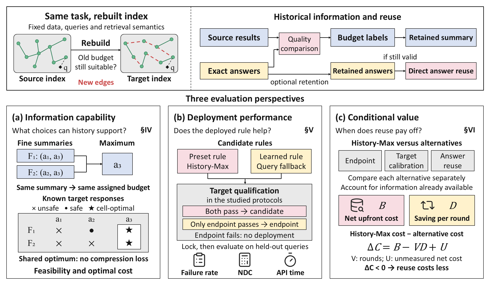

# Reading the research overview

[Project home](../README.md) · [Current manuscript and evidence](manuscript/EVIDENCE.md)

Figure 1 appears at the top of page 3, alongside Section III's framework description; the introduction first points readers to it. The lower panels are three evaluation perspectives, not successive execution stages. The graphic is the approved manuscript figure, reused without redrawing.

## Same task, rebuilt index

The two graphs use the same query and point positions. Changed edges illustrate rebuilding while keeping data, queries, and retrieval semantics fixed. Search results are compared with exact answers to obtain budget labels, from which summaries can be retained. Keeping the exact answers is optional; direct answer reuse additionally requires that those answers remain valid. The graphs and records are schematic.

## A. Information limits

A deterministic summary-only policy assigns the same budget to queries with the same summary. The example merges two fine-summary cells into one maximum-label cell. Its matrix marks cell-common safe actions and cell-cost minima, computed from known target responses. Different smallest safe budgets can still share a cost-minimizing safe action; in this example compression is lossless.

The example illustrates the condition, not a measured result or a deployable oracle. A minimum safe budget is not necessarily the minimum measured cost. Information constraints and an additional order restriction are analyzed separately in Section IV.

## B. Quality recovery

The diagram distinguishes preset and learned rules, including query-level fallback for learned mappings. Target qualification then selects the candidate when both checks pass, the endpoint when only it passes, or no deployment when the endpoint fails. These are the studied protocols' rules, not a universal requirement of the framework. Each method retains its own declared qualification event.

The deployment decision is locked before evaluation. Recall-threshold failure rate, distance computations, and ANN API time describe different outcomes; a cost comparison alone does not establish matched quality. Target-calibrated fixed budgets provide a separate reference beyond the conservative endpoint.

## C. Conditional value

History-Max is compared separately with an endpoint, target calibration, or valid-answer reuse. For each comparison, net cost is `B − V D + U`: net upfront cost `B`, per-round savings `D`, complete access rounds `V`, and unmeasured net cost `U`. Negative net cost means reuse costs less than that particular alternative. Available information determines which remaining acquisition costs apply. This accounting neither combines the alternatives into one pipeline nor guarantees that break-even occurs.

Answer reuse is a relevant alternative only when exact answers have been obtained, retained, and remain valid for the data and retrieval semantics. The fixed-data banner describes this setting; it does not assert validity after member or semantic changes. Conditional break-even is a model outcome, not an end-to-end deployment speedup.

## Editable source and attribution

The [v4 release](https://github.com/edwards365/when-is-cross-index-search-budget-reuse-worthwhile/releases/tag/artifact-manuscript-v4) supplies the unchanged approved PPTX, PDF, and PNG. Small Lucide icons retain their ISC attribution in `LUCIDE_LICENSE`; project-specific arrangements remain covered by the repository license. The release includes figure provenance and the full manuscript-to-evidence entry.

The [evidence map](manuscript/EVIDENCE.md) links the figure's questions to available numerical materials.
